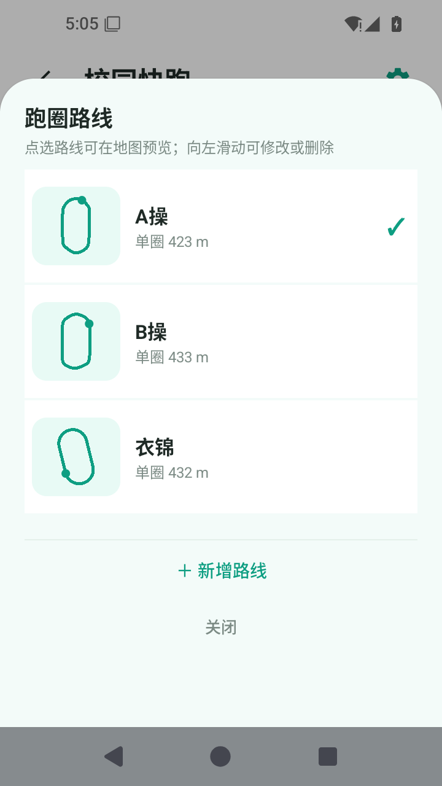
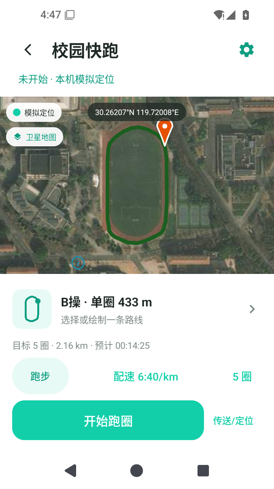
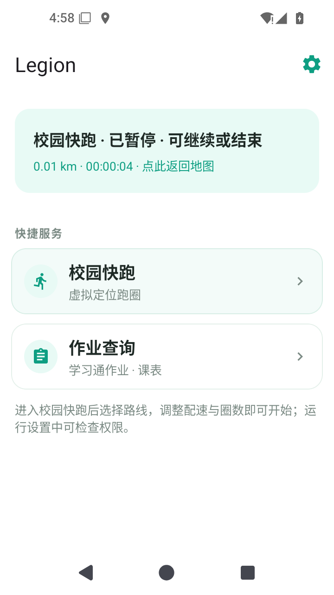

# 地图主页、路线预览与精确输入

日期：2026-11-16。基线：`5777bd5` / v0.8.4。

## 完成内容

- A：路线列表与当前路线卡片显示按真实路线几何绘制的缩略预览和起点。选择路线后主地图显示路线并取景，保留激活码导入和重名处理。
- B：支持 `分:秒/km` 与 `km/h` 两种精确输入、速度滑条，以及圈数数字输入和加减。速度范围 0.5–60 km/h，圈数 1–1000；输入错误保留弹窗并定位到字段。切换输入单位与直接保存不会把已有小数速度量化到整数秒。
- 步行、跑步、骑行分别保存速度，兼容旧配速和已有浮窗预设；主页面和浮窗共享预设、运动类型及运行目标速度。运行中修改速度立即生效，圈数在开始前固定。
- C：进入校园快跑直接显示地图。状态、路线与目标、参数、开始/暂停/继续/结束按层级排列；自然变速、扰动、浮窗和环境检查进入运行设置。无路线时主按钮打开路线选择；完成或取消绘制后返回地图。
- 首页显示活动任务及返回入口；检查更新移动到应用设置下的独立页面，原检查、下载、校验和安装方法保持一致。
- 激活预设后返回已有地图实例会刷新路线；结果页关闭后地图保留本次结果。

## 自测

环境：Windows、JDK 17、Android SDK 35、Android 15 x86_64 AVD。界面走查覆盖 1080×2340 与 720×1280 分辨率，后者为 360×640dp。

执行命令：

```powershell
.\gradlew.bat :route-core:test :simulation-core:test :app:testDebugUnitTest :app:connectedDebugAndroidTest :app:lintDebug :app:assembleDebug --console=plain
```

| 检查 | 结果 |
| --- | --- |
| route-core JVM | 107 通过 |
| simulation-core JVM | 55 通过 |
| app JVM | 228 通过（含 4 项新增数字输入用例） |
| Android 交互回归 | 6 项全部通过：地图入口/路线选择和绘制取消、精确输入与重建恢复、运行设置与更新入口、任务控制和首页返回、实际浮窗改速与自然变速、已有地图激活预设刷新 |
| 路线面板最终调整 | 对应交互用例通过，关闭按钮底边位于系统导航栏上方 |
| Debug APK | 构建通过 |
| Android Lint | 0 errors |

交互测试运行真实模拟定位服务，检查开始、暂停、继续、外部服务命令和结束。浮窗切换为骑行后连续观察 5.5 秒，速度保持在新目标附近，返回地图的类型与目标配速一致。更新页的检查、下载、校验和安装方法与原实现文本对照一致；测试覆盖设置到更新页的导航。

截图覆盖路线列表、选中路线、精确参数、更新页面、首页暂停任务和运行中地图。







## 复审处理

- 参数行在窄屏布局中保留运动类型、配速、圈数三个入口；圈数加减位于输入弹窗内。
- 速度转换保留精确草稿，取消编辑不写入配置。
- 运行任务使用启动时的圈数；圈数控件在任务活动时禁用。
- 地图与高级设置来回切换保留任务，首页入口恢复原 runId。
- 默认改为地图后，预设刷新条件改为“空闲且没有绘制”，补充返回已有地图的激活回归场景。
- 活动任务返回首页时保留地图实例；自然变速定时读取服务最新快照，在地图不可见时继续变化，首页入口将原任务带回前台。
- 路线缩略图复用 Path，运行快照刷新时相同路线不重复重绘。
- 路线选择面板根据屏幕可用高度限制列表，并给底部系统导航栏保留空间。

本轮范围对应上游 #25、#30、#32；#26、#27、#28、#29、#31 保持后续处理。
